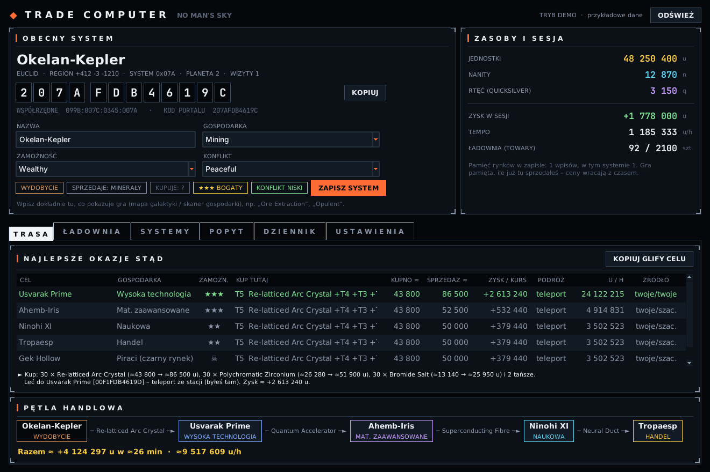
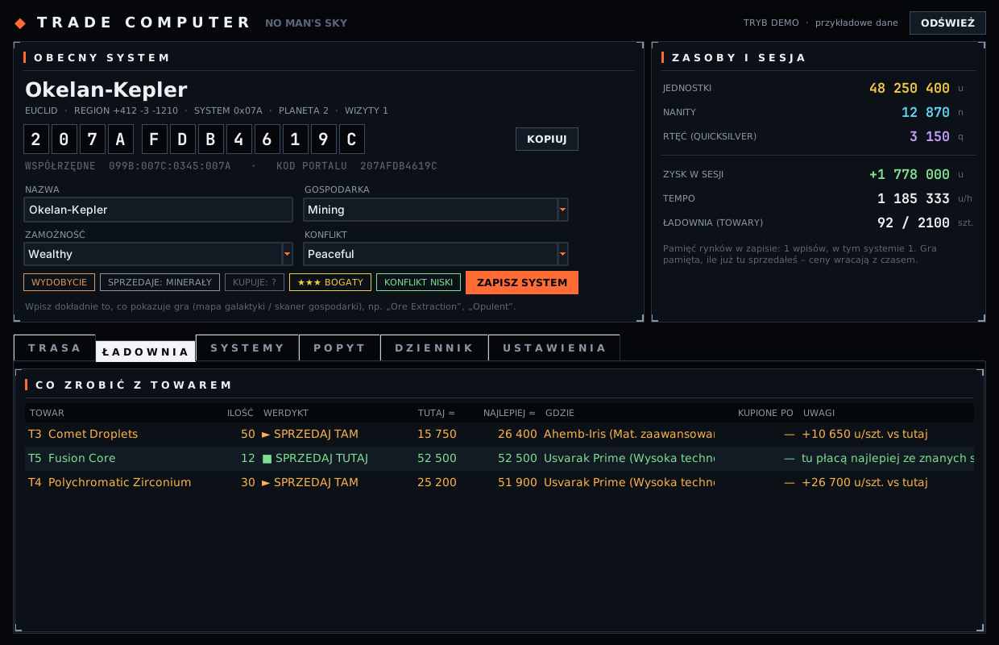
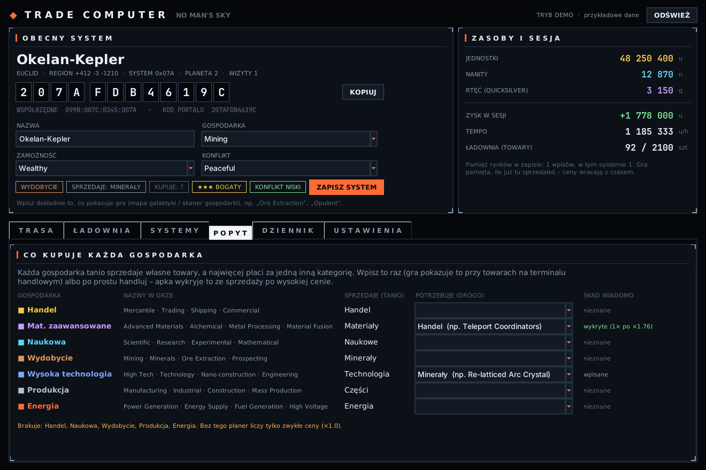

# NMS Trade Computer

Komputer handlowy do **No Man's Sky** na Linuksa (Steam / Proton) i Windowsa. To odpowiednik
[ed-trade-overlay](https://github.com/SyriusM/ed-trade-overlay) dla NMS, z interfejsem w stylu gry.

Apka czyta plik zapisu gry i wie, gdzie jesteś (glify portalu, galaktyka, region), ile masz jednostek,
nanitów i rtęci oraz jakie towary handlowe wieziesz. Na tej podstawie podpowiada, co kupić, dokąd lecieć
i gdzie sprzedać. **Niczego w grze nie zmienia**: tylko czyta zapis.



## Czym NMS różni się od Elite

W Elite gra zapisuje journal na bieżąco, a ceny z rynków spływają do wspólnej sieci (EDDN). W NMS nie ma
ani jednego, ani drugiego: rynki są generowane w każdym systemie osobno, a gra zapisuje stan tylko przy
zapisie gry (autozapis po wyjściu ze stacji, skoku, lądowaniu, ręczny zapis). Dlatego:

- **pozycję, portfel i ładownię** apka bierze z pliku zapisu (`save*.hg`), automatycznie po każdym zapisie;
- **gospodarkę i zamożność** systemu wpisujesz raz, tak jak pokazuje je gra (np. „Ore Extraction”,
  „Opulent”). Pole podpowiada nazwy z gry i samo rozpoznaje, czy to Wydobycie, czy ★★★;
- **transakcje** apka wykrywa z różnicy między dwoma zapisami w tym samym systemie: ubyło towaru i
  przybyło jednostek, czyli sprzedaż. Z tego liczy Twoje prawdziwe ceny.

## Co umie

**Obecny system:** nazwa, 12 glifów portalu (z przyciskiem *Kopiuj*), współrzędne z wzmacniacza sygnału,
galaktyka, gospodarka, zamożność i konflikt. Po wejściu do nowego systemu pojawia się pasek z prośbą o
wpisanie gospodarki.

**Trasa:** ranking celów wg jednostek na godzinę. Zakup łączy kilka poziomów towaru (T5, potem T4, T3…),
bo stacja ma ograniczony zapas każdego. Czas podróży: teleport między stacjami, które już odwiedziłeś,
albo skoki hipernapędem wg zasięgu. Poniżej **pętla handlowa**, czyli kilka kursów z rzędu bez powtarzania
systemów.

**Ładownia:** dla każdego towaru werdykt `■ SPRZEDAJ TUTAJ`, `► SPRZEDAJ TAM` (gdzie i o ile więcej) albo
`■ TRZYMAJ` (brak lepszego kupca albo sprzedaż poniżej ceny zakupu).



**Popyt:** tabela „która gospodarka płaci najwięcej za co”. Co gospodarka *sprzedaje*, wiadomo z danych
gry. Co *kupuje* drogo, apka uzupełnia sama ze sprzedaży powyżej progu (domyślnie ×1,3 ceny bazowej).
Możesz to też wpisać ręcznie, a Twój wpis nigdy nie jest nadpisywany.



**Systemy:** baza wszystkich odwiedzonych systemów (dodają się same) plus ręczne dopisywanie z glifów,
np. bogatych systemów z r/NMSCoordinateExchange.

**Dziennik i sesja:** każda wykryta transakcja z ceną i mnożnikiem ceny bazowej, zysk w sesji i tempo u/h.

## Skąd są dane (i czego apka nie zgaduje)

| Co | Źródło | Pewność |
|---|---|---|
| Format zapisu (bloki LZ4 `0xFEEDA1E5`) | NMSCD/NMS-Save-Decoder | pewne |
| Klucze zapisu (`6f=` → `PlayerStateData`…) | `mapping.json` z MBINCompiler 7.10 (`nmstrade/data/`) | pewne dla tej wersji gry |
| 35 towarów handlowych i 8 przemycanych: ID, nazwy, ceny bazowe | zrzut danych gry (Trade.json z NMSE) | pewne |
| Nazwy gospodarek, zamożności i konfliktów z gry | tabela językowa gry (en-GB) | pewne |
| Co każda gospodarka sprzedaje | tabela gry `GcTradingClassTable` | pewne |
| **Co każda gospodarka kupuje drogo** | **uczy się z Twoich sprzedaży / wpisujesz Ty** | celowo nie zgadujemy |
| Mnożniki cen (popyt ×1,7, zakup lokalny ×0,88, zamożność ±5%) | szacunek, do zmiany w ustawieniach | do czasu pierwszych transakcji |

Kolumna *Źródło* w tabeli tras mówi, skąd jest cena: `twoje` (Twoje prawdziwe transakcje), `popyt`
(z tabeli popytu) albo `szac.` (szacunek).

Jeśli po dużej aktualizacji gry zapis przestanie się czytać, wystarczy podmienić
`nmstrade/data/mapping.json` na nowszy z
[wydań MBINCompiler](https://github.com/monkeyman192/MBINCompiler/releases).

## Uruchomienie

Wymagania: Python 3.10+ z Tk. Bez innych zależności. Opcjonalnie `lz4`, które przyspiesza czytanie dużych zapisów.

```bash
git clone https://github.com/SyriusM/nms-trade-computer.git
```

```bash
cd nms-trade-computer
```

```bash
pip install lz4          # opcjonalnie
```

```bash
python -m nmstrade.main  # sam znajdzie zapisy (Proton: steamapps/compatdata/275850/...)
```

Przydatne opcje:

```bash
python -m nmstrade.main --demo                 # podgląd na przykładowych danych, bez gry
```

```bash
python -m nmstrade.main --list                 # gdzie są Twoje zapisy
```

```bash
python -m nmstrade.main --dump                 # co apka odczytała z najnowszego zapisu
```

```bash
python -m nmstrade.main --save-dir ~/ścieżka/HelloGames/NMS
```

Grę najlepiej uruchomić w oknie bez ramek. Apka ma opcję *Okno zawsze na wierzchu*. Dane apki (systemy,
popyt, dziennik, ustawienia) leżą w `~/.config/nms-trade-computer/`.

## Testy

```bash
xvfb-run -a python -m unittest discover -s tests -t . -v
```

Testy budują prawdziwy zapis (zaciemnione klucze + bloki LZ4) i sprawdzają cały tor danych: odczyt,
glify, wykrywanie sprzedaży, naukę popytu, planer i GUI.
